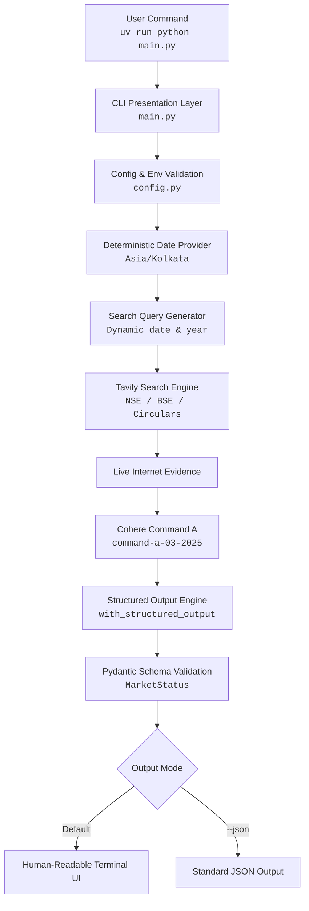
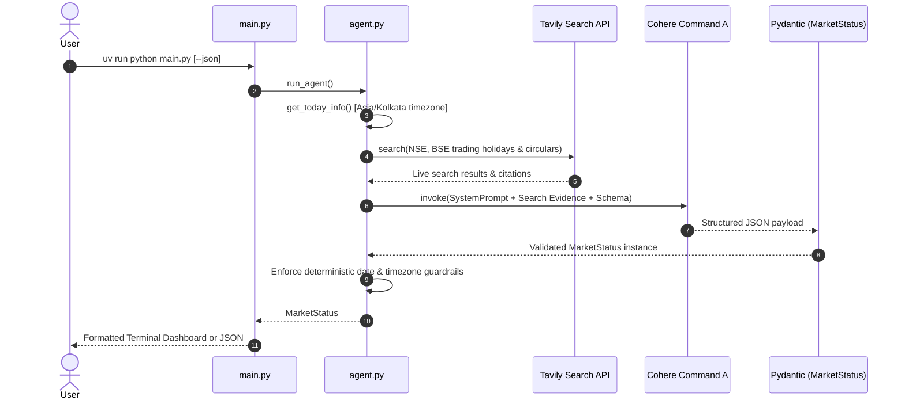

# Indian Stock Market Holiday Checker 🇮🇳📈

An AI-powered agent that determines whether the Indian stock market (NSE and BSE) is **OPEN** or **CLOSED** today by searching the internet for current information.

## Architecture



### Agent Workflow (Sequence Diagram)



1. **Python** dynamically determines today's date and weekday in the `Asia/Kolkata` timezone (preventing LLM hallucination of dates).
2. **Tavily Search** retrieves real-time evidence regarding NSE/BSE trading holidays and exceptional sessions.
3. **Cohere (Command A)** analyzes search results, distinguishes trading holidays from settlement holidays, and evaluates market status.
4. **Pydantic** validates and enforces the response schema before rendering.

---

## Technology Stack

| Component | Technology |
|---|---|
| Language | Python 3.11+ |
| LLM | Cohere Command A (`command-a-03-2025`) |
| LLM Integration | langchain-cohere |
| Agent Framework | LangChain |
| Search Provider | Tavily Search |
| Search Integration | langchain-tavily |
| Schema Validation | Pydantic |
| Environment Variables | python-dotenv |
| Package Manager | uv |
| Testing | pytest |

---

## Prerequisites

- **Python 3.11+** installed on your system.
- **uv** package manager. Install from [https://docs.astral.sh/uv/getting-started/installation/](https://docs.astral.sh/uv/getting-started/installation/).
- **Cohere API Key** — Sign up at [https://dashboard.cohere.com/](https://dashboard.cohere.com/).
- **Tavily API Key** — Sign up at [https://app.tavily.com/](https://app.tavily.com/).

---

## Setup

### 1. Clone and enter the project

```bash
git clone https://github.com/reck98/TradeDay.git
cd TradeDay
```

### 2. Install dependencies

```bash
uv sync
```

This will automatically create the `.venv` and install all dependencies locked in `uv.lock`.

### 3. Configure environment variables

Copy the example environment file and add your API keys:

```bash
cp .env.example .env
```

Edit `.env`:

```env
COHERE_API_KEY=your_actual_cohere_api_key
TAVILY_API_KEY=your_actual_tavily_api_key
```

### How to obtain API keys

**Cohere API Key:**
1. Visit [https://dashboard.cohere.com/](https://dashboard.cohere.com/).
2. Sign up or log in.
3. Navigate to **API Keys**.
4. Create a new key or copy an existing one.

**Tavily API Key:**
1. Visit [https://app.tavily.com/](https://app.tavily.com/).
2. Sign up or log in.
3. Copy your API key from the dashboard overview.

---

## Usage

### Check market status (human-readable)

```bash
uv run python main.py
```

Example output:

```text
==================================================
          INDIAN STOCK MARKET STATUS
==================================================

Date       : 2026-10-31 (Saturday)
Timezone   : Asia/Kolkata
Market     : NSE + BSE

Status     : CLOSED

Reason:
  The NSE and BSE are typically closed on weekends
  unless a special trading session is announced. No
  special session is indicated for this date.

Special Session: No

Verified Sources:
  1. https://www.nseindia.com/resources/exchange-communication-holidays
  2. https://www.bseindia.com/static/markets/marketinfo/listholi

Last Verified: 2026-10-31T14:19:54.815475+05:30

==================================================
```

### Check market status (JSON)

```bash
uv run python main.py --json
```

Returns a validated JSON response:

```json
{
  "date": "2026-10-31",
  "weekday": "Saturday",
  "timezone": "Asia/Kolkata",
  "market": "BOTH",
  "status": "CLOSED",
  "is_holiday": false,
  "holiday_name": null,
  "reason": "The NSE and BSE are typically closed on weekends unless a special trading session is announced. No special session is indicated for this date.",
  "special_session": false,
  "session_details": null,
  "source_urls": [
    "https://www.nseindia.com/resources/exchange-communication-holidays",
    "https://www.bseindia.com/static/markets/marketinfo/listholi"
  ],
  "last_verified": "2026-10-31T14:20:27.400688+05:30"
}
```

---

## Structured Output Schema

The agent returns a `MarketStatus` Pydantic model with strict validation:

| Field | Type | Description |
|---|---|---|
| `date` | str | Date in YYYY-MM-DD format |
| `weekday` | str | Weekday name (e.g. Monday, Saturday) |
| `timezone` | str | Always `Asia/Kolkata` |
| `market` | str | `NSE`, `BSE`, or `BOTH` |
| `status` | Literal | `OPEN`, `CLOSED`, or `UNKNOWN` |
| `is_holiday` | bool/None | Whether today is an officially declared trading holiday |
| `holiday_name` | str/None | Name of the trading holiday, if applicable |
| `reason` | str | Explanation of the result based on verified evidence |
| `special_session` | bool | Whether a special session exists (e.g., Muhurat Trading) |
| `session_details` | str/None | Special session details and timings |
| `source_urls` | list[str] | Sources used for verification |
| `last_verified` | str | ISO 8601 verification timestamp |

The agent uses LangChain's `with_structured_output()` to request the LLM to return a response matching the Pydantic schema. Deterministic fields (`date`, `weekday`, `timezone`) are enforced by Python guardrails so the LLM cannot override them.

---

## Testing

Run all unit and integration tests:

```bash
uv run pytest
```

Run tests with verbose output:

```bash
uv run pytest -v
```

Tests mock external API calls (Cohere and Tavily) and cover:
- Regular weekday, Saturday, and Sunday detection
- Officially declared trading holidays
- Muhurat Trading and special sessions
- Distinct NSE and BSE market statuses
- Settlement holiday vs. trading holiday distinction
- Search API failure fallback to `UNKNOWN`
- Cohere API failure and invalid schema fallback
- Pydantic schema constraints and date formatting
- Timezone boundary conditions (`Asia/Kolkata`)

---

## Project Structure

```
TradeDay/
├── main.py          # Entry point and terminal formatting
├── config.py        # Environment variables and configuration
├── agent.py         # LangChain agent workflow & structured output
├── tools.py         # Tavily search tool setup
├── schemas.py       # Pydantic MarketStatus model
├── prompts.py       # Agent system instructions
├── tests/
│   ├── __init__.py
│   ├── test_date.py          # Date and timezone tests
│   ├── test_market_status.py # Schema validation tests
│   └── test_agent.py         # Agent integration tests
├── .env.example     # Template for environment configuration
├── .gitignore       # Excludes .env, .venv, and build caches
├── pyproject.toml   # Project metadata and uv dependencies
├── uv.lock          # Locked dependency tree
├── LICENSE          # MIT License
└── README.md        # Documentation and architecture diagrams
```

---

## License

This project is licensed under the [MIT License](LICENSE).
